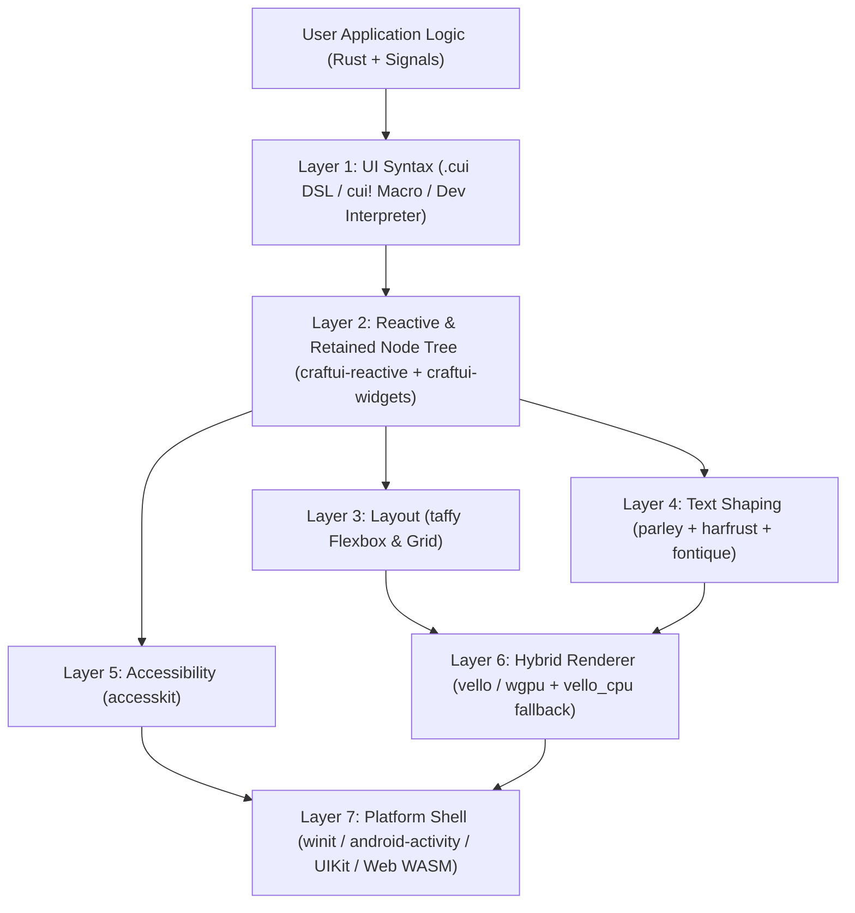
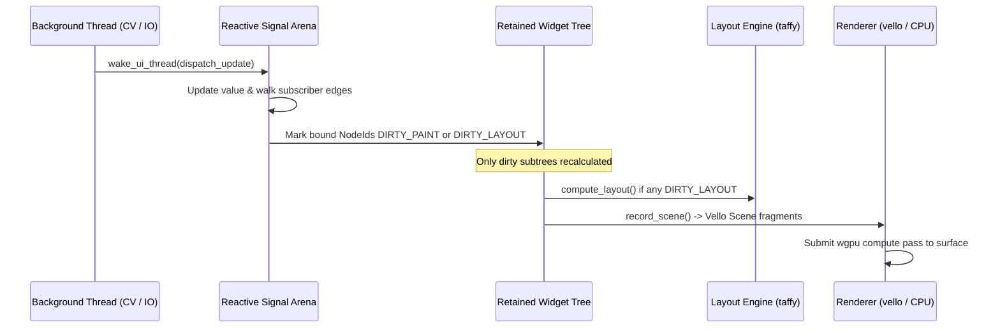
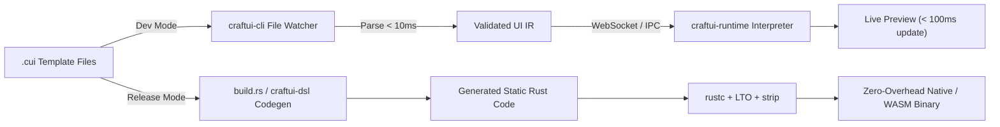
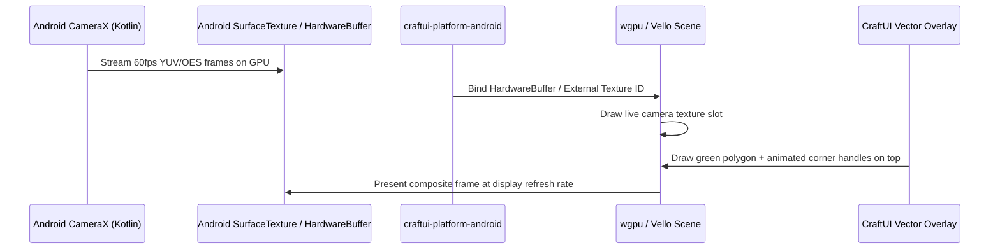

# CraftUI — System Architecture & Workspace Design (`ARCHITECTURE.md`)

## 1. Architectural Philosophy

CraftUI avoids the two classic GUI traps:
1. **No Virtual DOM Overhead:** Instead of diffing huge trees on every state change (React/Dioxus style), CraftUI uses **Fine-Grained Signals + Retained Layout/Render Tree**. Updating a slider only invalidates the affected node's paint/layout flags.
2. **No Monolithic Re-implementation:** CraftUI delegates ultra-hard, non-differentiating subsystems (Flexbox math, Unicode/BiDi text shaping, OS windowing, GPU vector rasterization, OS accessibility bridges) to mature MIT/Apache-2.0 crates, focusing engineering effort on reactivity, DSL compilation, ergonomics, mobile polish, and platform embedding.

---

## 2. Seven-Layer System Architecture



---

## 3. Cargo Workspace Structure

```text
craftui/
├── Cargo.toml                         # Workspace root, shared lints & release profiles
├── deny.toml                          # Strict MIT/Apache-2.0 license gatekeeper
├── crates/
│   ├── craftui-core/                  # Geometry (Point, Rect, Size), Color, Constraints, NodeId, Events
│   ├── craftui-reactive/              # SlotMap Signal arena, Scope tree, Computed, Effect, Scheduler
│   ├── craftui-layout/                # Taffy bridge, SafeArea insets, responsive layout cache
│   ├── craftui-text/                  # Parley + Fontique + Glyph Atlas + IME selection/cursor math
│   ├── craftui-render/                # Renderer trait, Vello GPU backend, CPU fallback, TextureRegistry
│   ├── craftui-a11y/                  # AccessKit tree synchronization & action routing
│   ├── craftui-widgets/               # Standard widgets, GestureArena, ScrollPhysics, ThemeScope
│   ├── craftui-dsl/                   # .cui Lexer/Parser (logos/rowan), AST, Validator, Rust Codegen
│   ├── craftui-runtime/               # Dev-mode dynamic AST/bytecode interpreter for <100ms hot-reload
│   ├── craftui-macros/                # cui! inline proc-macro & #[component] attribute macro
│   ├── craftui-platform-desktop/      # winit desktop runner + native file dialog / clipboard
│   ├── craftui-platform-android/      # android-activity + JNI + IME bridge + SurfaceTexture PlatformView
│   ├── craftui-platform-ios/          # UIKit/Metal runner + safe area + keyboard notifications
│   ├── craftui-platform-web/          # wasm-bindgen + WebGPU/WebGL2 + hidden DOM input IME bridge
│   └── craftui/                       # Unified public facade crate re-exporting user APIs
├── tools/
│   ├── craftui-cli/                   # CLI: `craftui new`, `dev`, `preview`, `build`
│   └── craftui-lsp/                   # Language Server Protocol for .cui files
└── examples/
    ├── counter/                       # Minimal cross-platform starter
    └── scancraft_studio_demo/         # Real-world dogfooding app (image filters + crop + grid)
```

---

## 4. Core Pipelines & Data Flow

### 4.1 Fine-Grained Frame Update Pipeline (Zero VDOM Diffing)

Every widget node lives inside a flat `SlotMap<NodeId, WidgetNode>` arena. Each node stores bitflags: `DIRTY_LAYOUT`, `DIRTY_PAINT`, `DIRTY_A11Y`.



**Why this matters:** When dragging a brightness slider or crop handle at 120Hz, **zero memory allocations** happen for unrelated widgets — only the handle transform or image texture uniform updates.

---

### 4.2 Dual Compilation Pipeline (Dev Hot-Reload vs Release AOT)



* **Dev Mode:** Only Rust business logic compiles once; UI `.cui` files interpret dynamically in `craftui-runtime`, giving Flutter/Web-like instant visual iteration.
* **Release Mode:** The interpreter crate is completely compiled out (`#[cfg(feature = "hot-reload")]`), leaving pure statically typed Rust code with dead-code elimination and LTO.

---

### 4.3 Android Native Surface & Zero-Copy CV Pipeline (`PlatformView`)

For apps like **ScanCraft** (live CameraX preview + C++/Rust CV overlays + Android hardware bitmaps), rendering camera frames through CPU copies is too slow. CraftUI solves this via **External Texture / Hole-Punch Composition**:



1. **Two Composition Modes:**
   - **External Texture Mode (Preferred for Camera/Video):** Native surface renders directly into an offscreen GPU texture (`AHardwareBuffer` on Android, `CVPixelBuffer` on iOS) imported into `wgpu`. CraftUI can clip, rotate, blur, and draw vector overlays *both behind and in front of* the native feed!
   - **Hole-Punch Mode (Fallback for Maps/WebView):** CraftUI punches a transparent cutout (`BlendMode::Clear`) in its surface and positions a native Android `View` / iOS `UIView` synchronized with `taffy` bounds.

---

## 5. Threading & Memory Model

1. **UI Thread Owns All Arenas:**
   - `SignalArena`, `WidgetTree`, `TaffyTree`, `ParleyFontContext`, and `wgpu::Surface` live strictly on the main/UI thread.
   - Because access is single-threaded inside the event loop, signals use zero-cost interior mutability (`Cell` / `RefCell` hidden inside `craftui-reactive` internals) with **no mutex contention during layout/paint**.
2. **Thread-Safe Handle (`UiDispatcher`):**
   - Background threads (`tokio`, `rayon`) receive a `Send + Sync` `UiDispatcher` handle backed by `winit::EventLoopProxy`.
   - Calling `dispatcher.post(|| signal.set(new_data))` safely wakes the UI loop without blocking worker threads.
3. **Texture Streaming for Heavy Media:**
   - Heavy 12MP–24MP image decodes or filters run on `rayon` threads into aligned `Vec<u8>` RGBA buffers and upload via `wgpu::Queue::write_texture` once ready, preventing UI thread jank.

---

## 6. Key Technical Decisions & Trade-Offs

| Decision | Choice Made | Why |
| :--- | :--- | :--- |
| **Rendering Backend** | `vello` (`wgpu`) + `vello_cpu`/`tiny-skia` fallback | Pure MIT/Apache-2.0; handles arbitrary Bézier paths, gradients, and crisp vector UI at GPU speed without shipping Skia C++ (~15MB+ build pain). |
| **Layout Engine** | `taffy` | Battle-tested pure-Rust MIT Flexbox & CSS Grid engine used by Bevy, Dioxus Blitz, and Servo experiments. |
| **Text Stack** | `parley` + `harfrust` | Handles Indic/Devanagari, Arabic BiDi, multi-font fallback, and IME metrics cleanly in pure Rust under Apache-2.0/MIT. |
| **Reactivity** | Generational Arena Signals (`slotmap`) | Eliminates `move` + `.clone()` boilerplate in Rust UI closures while avoiding Virtual DOM tree allocations. |
| **Web Strategy** | WebGPU/WebGL2 Canvas first, DOM projection trait optional | Guarantees 100% visual & custom-canvas parity (e.g., drawing tools, crop loupes) from day one. |
