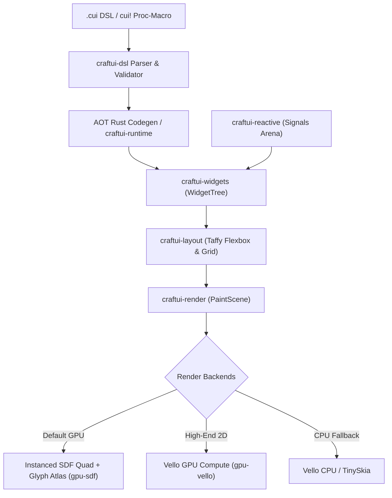

# Introduction to CraftUI

Welcome to **CraftUI**, a modern, lightweight, high-performance cross-platform GUI framework written in Rust.

CraftUI is built from first principles to provide:
1. **Unrivaled Rendering Performance:** GPU-accelerated 2D vector & text rendering via WGPU (Vulkan, DirectX 12, Metal, WebGPU) with instant fallback to optimized software rasterization.
2. **True Cross-Platform Autonomy:** Tier-1 support for Linux Desktop and Android directly from a Linux host, plus WebAssembly and Windows. *macOS and iOS hardware is never required to build and test your apps.*
3. **Ergonomic Declarative DSL (`.cui`):** Beautiful, concise UI definition syntax with fine-grained reactivity, two-way data binding, spring animations, and glassmorphism.
4. **Zero-Boilerplate Mobile Capabilities:** Unified 35-permission security model and automatic manifest generation (`craftui.toml`) mapping transparently to Android XML and iOS Info.plist.
5. **Ultra-Lightweight Footprint:** Stripped release binaries under 15 MB on Desktop, under 1 MB on WebAssembly, and sub-750 KB on Android arm64.

---

## Architectural Pillars

- **Reactivity without Virtual DOM:** Changes propagate directly from modified `Signal`s to subscribed widgets and layout nodes with zero full-tree diffing overhead.
- **Demand-Driven Power:** Pure 0% CPU consumption when idle; timers, animations, and caret blinking wake the event loop only when needed.
- **Production Accessibility:** Incremental AccessKit synchronization out-of-the-box for screen readers across Desktop and Web.
