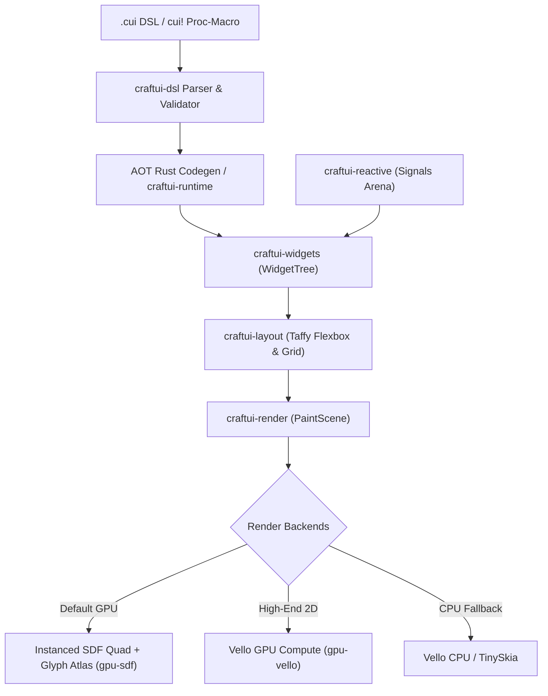

# Introduction to CraftUI

Welcome to **CraftUI**, a modern, lightweight, high-performance cross-platform GUI framework written in Rust.

CraftUI aims to provide:
1. **GPU rendering with a CPU fallback:** 2D vector and text rendering through WGPU (Vulkan, DirectX 12, Metal, WebGPU), with software rasterizers for machines without a usable GPU.
2. **One codebase for desktop, Android and the Web:** all three can be built from a Linux machine. iOS support exists in the source tree but is not built or tested in CI.
3. **A declarative UI language (`.cui`):** concise markup with fine-grained reactivity, two-way bindings and animations, compiled to Rust at build time.
4. **One manifest for packaging:** `craftui.toml` holds the app id, version and permissions, and the CLI generates the Android project from it.

What is verified today, and how, is listed in the repository README. Binary
sizes measured in CI for the notes example are about 6.2 MB for the WebAssembly
module and 8.9 MB for the Android `arm64-v8a` library, both before compression.

---

## Architectural Pillars

- **Reactivity without Virtual DOM:** Changes propagate directly from modified `Signal`s to subscribed widgets and layout nodes with zero full-tree diffing overhead.
- **Demand-Driven Power:** Pure 0% CPU consumption when idle; timers, animations, and caret blinking wake the event loop only when needed.
- **Production Accessibility:** Incremental AccessKit synchronization out-of-the-box for screen readers across Desktop and Web.
