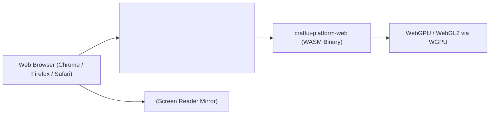

# WebAssembly (WASM) Deployment

CraftUI compiles to a compact WebAssembly binary running on any modern browser.

---

## 1. Web Architecture



- **Dual Graphics Pipeline:** Automatically uses WebGPU if available, gracefully dropping down to WebGL2 without requiring compute shaders.
- **Accessibility Mirror:** DOM ARIA nodes are synchronized with the widget tree so screen readers work out of the box.
- **Microscopic Footprint:** Release WASM binary is approximately 1 MB uncompressed and ~310 KB with gzip/Brotli compression.

---

## 2. Building for Web

Run the platform build command:

```bash
craftui build --platform web --release
```

This generates a standalone `dist/` folder containing:
- `index.html`
- `my_app.wasm`
- `my_app.js` (JavaScript glue generated by `wasm-bindgen`)

---

## 3. Local Testing Server

Because WebAssembly and Web Workers require proper MIME headers (`application/wasm`), `craftui-cli` includes a zero-dependency local HTTP server:

```bash
craftui run --platform web
```
This serves `dist/` on `http://localhost:8080` with automatic browser opening.
